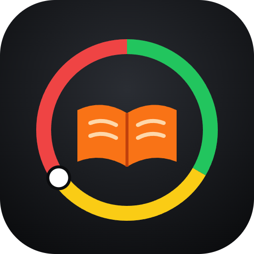
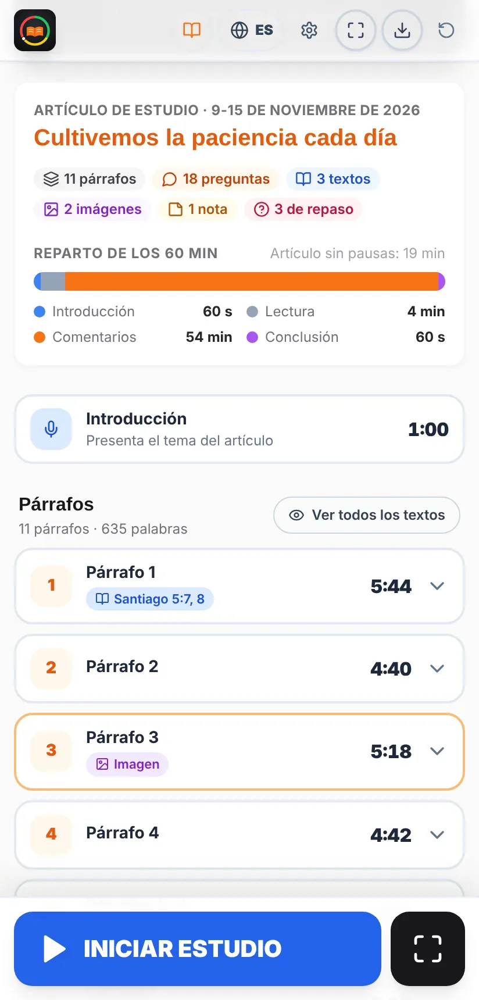
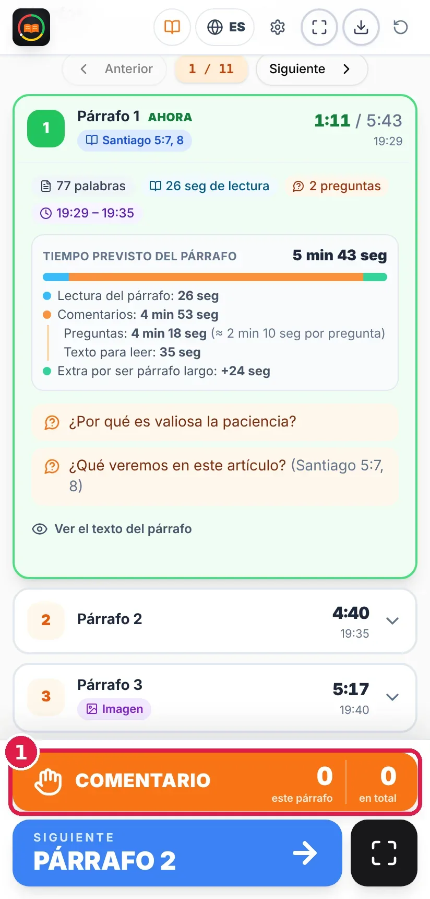
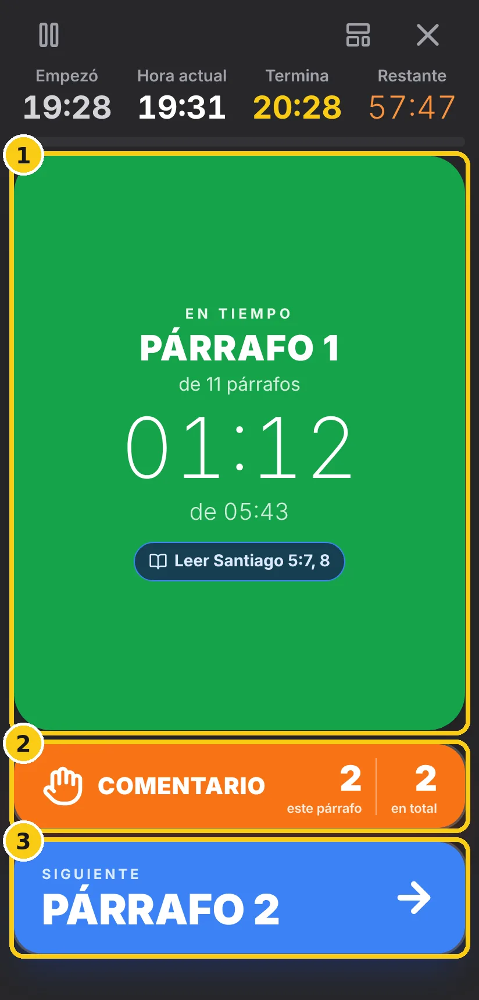
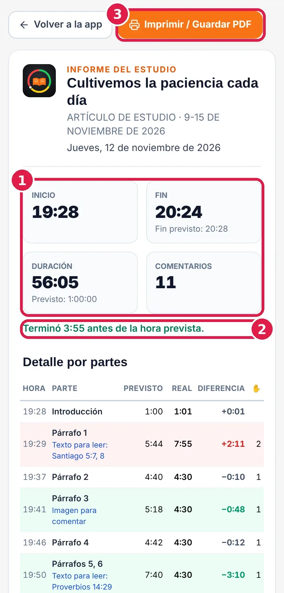

<p align="center">
  
</p>

<h1 align="center">Temporizador de Estudio</h1>

<p align="center">
  Controla el tiempo al conducir el estudio semanal de La Atalaya y termina a la hora, sin correr al final.
</p>

<p align="center">
  <a href="https://temporizador-estudio.vercel.app"><b>Abrir la app</b></a> ·
  <a href="https://play.google.com/store/apps/details?id=com.comangelo.temporizadorestudio">Google Play</a> ·
  <a href="https://temporizador-estudio.vercel.app/guia-rapida.html">Guía rápida</a> ·
  <a href="https://temporizador-estudio.vercel.app/manual.html">Manual de uso</a>
</p>

<p align="center">
  
  
  
  
</p>

> Aplicación no oficial, sin relación con jw.org. Las capturas usan un artículo de ejemplo inventado.

## Qué hace

1. **Lee el artículo de la semana.** Abres el PDF de la revista que has descargado de jw.org y la app encuentra sola el artículo de esa semana: párrafos, preguntas, textos para leer, imágenes, notas y repaso.
2. **Reparte los 60 minutos.** Calcula cuánto lleva leer cada párrafo y responder a sus preguntas, y distribuye el tiempo según el contenido, no según la posición. Así no sobra tiempo al principio ni falta al final.
3. **Te guía durante el estudio.** Cada párrafo cambia de color: verde, a tiempo; amarillo, ve cerrando; rojo, pasa al siguiente. El botón «Siguiente» avisa cuando ya no queda tiempo que recuperar.
4. **Guarda un informe.** Al terminar ves cuánto duró cada parte frente a lo previsto, y el historial de estudios anteriores.

También tiene:
- **Modo presentación** a pantalla completa.
- **Visita del superintendente** (estudio de 30 minutos).
- **Reservas de comentarios** para anotar quién pidió comentar en un párrafo.
- **Avisos y vibración.**
- **Modo oscuro.**
- **Funcionamiento sin conexión.**

## Idiomas

Español, catalán, euskera, gallego, inglés, alemán, italiano, francés, portugués (Portugal y Brasil), polaco, neerlandés, rumano, noruego y sueco. Cada idioma tiene su manual, su guía rápida y el manual en PDF:

| Idioma | Manual | Guía rápida | PDF |
|---|---|---|---|
| Español | [manual](https://temporizador-estudio.vercel.app/manual.html) | [guía](https://temporizador-estudio.vercel.app/guia-rapida.html) | [PDF](https://temporizador-estudio.vercel.app/manual_usuario.pdf) |
| Català | [manual](https://temporizador-estudio.vercel.app/manual-ca.html) | [guia](https://temporizador-estudio.vercel.app/guia-rapida-ca.html) | [PDF](https://temporizador-estudio.vercel.app/manual_usuario_ca.pdf) |
| Euskara | [eskuliburua](https://temporizador-estudio.vercel.app/manual-eu.html) | [gida](https://temporizador-estudio.vercel.app/guia-rapida-eu.html) | [PDF](https://temporizador-estudio.vercel.app/manual_usuario_eu.pdf) |
| Galego | [manual](https://temporizador-estudio.vercel.app/manual-gl.html) | [guía](https://temporizador-estudio.vercel.app/guia-rapida-gl.html) | [PDF](https://temporizador-estudio.vercel.app/manual_usuario_gl.pdf) |
| English | [manual](https://temporizador-estudio.vercel.app/manual-en.html) | [quick guide](https://temporizador-estudio.vercel.app/guia-rapida-en.html) | [PDF](https://temporizador-estudio.vercel.app/manual_usuario_en.pdf) |
| Deutsch | [Handbuch](https://temporizador-estudio.vercel.app/manual-de.html) | [Kurzanleitung](https://temporizador-estudio.vercel.app/guia-rapida-de.html) | [PDF](https://temporizador-estudio.vercel.app/manual_usuario_de.pdf) |
| Italiano | [manuale](https://temporizador-estudio.vercel.app/manual-it.html) | [guida](https://temporizador-estudio.vercel.app/guia-rapida-it.html) | [PDF](https://temporizador-estudio.vercel.app/manual_usuario_it.pdf) |
| Français | [manuel](https://temporizador-estudio.vercel.app/manual-fr.html) | [guide](https://temporizador-estudio.vercel.app/guia-rapida-fr.html) | [PDF](https://temporizador-estudio.vercel.app/manual_usuario_fr.pdf) |
| Português | [manual](https://temporizador-estudio.vercel.app/manual-pt.html) | [guia](https://temporizador-estudio.vercel.app/guia-rapida-pt.html) | [PDF](https://temporizador-estudio.vercel.app/manual_usuario_pt.pdf) |
| Polski | [instrukcja](https://temporizador-estudio.vercel.app/manual-pl.html) | [przewodnik](https://temporizador-estudio.vercel.app/guia-rapida-pl.html) | [PDF](https://temporizador-estudio.vercel.app/manual_usuario_pl.pdf) |
| Nederlands | [handleiding](https://temporizador-estudio.vercel.app/manual-nl.html) | [snelgids](https://temporizador-estudio.vercel.app/guia-rapida-nl.html) | [PDF](https://temporizador-estudio.vercel.app/manual_usuario_nl.pdf) |
| Română | [manual](https://temporizador-estudio.vercel.app/manual-ro.html) | [ghid](https://temporizador-estudio.vercel.app/guia-rapida-ro.html) | [PDF](https://temporizador-estudio.vercel.app/manual_usuario_ro.pdf) |
| Norsk | [brukerveiledning](https://temporizador-estudio.vercel.app/manual-nb.html) | [hurtigguide](https://temporizador-estudio.vercel.app/guia-rapida-nb.html) | [PDF](https://temporizador-estudio.vercel.app/manual_usuario_nb.pdf) |
| Svenska | [bruksanvisning](https://temporizador-estudio.vercel.app/manual-sv.html) | [snabbguide](https://temporizador-estudio.vercel.app/guia-rapida-sv.html) | [PDF](https://temporizador-estudio.vercel.app/manual_usuario_sv.pdf) |

## Privacidad

La app no tiene servidor ni cuentas de usuario.
- **El PDF se analiza en tu dispositivo.** No se envía a ningún sitio.
- **Los ajustes, las revistas guardadas y el historial** se quedan en el navegador o en el móvil.

Más detalles en la [política de privacidad](https://temporizador-estudio.vercel.app/privacidad) y en la página de [soporte](https://temporizador-estudio.vercel.app/soporte).

## Dónde está cada cosa

```
frontend/
├── public/            Páginas estáticas, iconos, manifest y service worker
│   ├── manual*.html     Manual de uso (14 idiomas) y manual_usuario*.pdf
│   ├── guia-rapida*.html Guía rápida en 7 pasos
│   ├── manual/  guia/   Capturas de los manuales
│   └── privacidad.html, soporte.html
└── src/
    ├── analysis/      Lector del PDF (pdf.js): párrafos, preguntas, semana, repaso
    ├── hooks/         Temporizador, cálculo del reparto, avisos, pantalla encendida
    ├── components/    Pantallas y tarjetas (componentes base en ui/)
    ├── pages/         Pantalla principal e informe
    ├── i18n/          Textos de la app en cada idioma
    └── utils/         Biblioteca de revistas, historial, novedades…
```

## Desarrollo

Hace falta Node 20 y Yarn 1.

```bash
cd frontend
yarn install
yarn start      # http://localhost:3000
yarn build      # versión de producción en frontend/build
```

Hecha con React, Tailwind CSS y pdf.js. Cada cambio en `main` se publica solo en [Vercel](https://temporizador-estudio.vercel.app). La app de Android es una Trusted Web Activity que abre esa misma web, así que los cambios llegan también a Android sin publicar una versión nueva.

## Licencia

Copyright 2026 safeSingleMark S.L.

El código se publica con la [licencia Apache 2.0](LICENSE). Mira también el archivo [NOTICE](NOTICE):
- **Nombre, logo e iconos:** no están incluidos en la licencia. Quien haga una copia debe usar su propio nombre e icono.
- **Publicaciones de jw.org:** pertenecen a sus propietarios y no forman parte de este repositorio.

---

**English.** Study timer for conducting the weekly Watchtower Study in 60 minutes. It reads the study article from the PDF downloaded from jw.org and splits the time by content. During the study it shows colour cues per paragraph, and it saves a report at the end. Available in 14 languages. Unofficial app, not affiliated with jw.org. Licensed under the [Apache License 2.0](LICENSE); see [NOTICE](NOTICE) for trademark and third-party terms.
